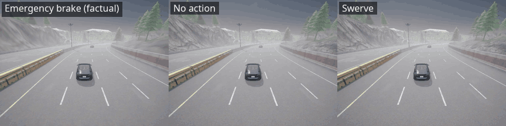

<h1 align="center">CORIVA</h1>

<p align="center">
  <b>Do vision-language models predict consistent futures under interventions?</b>
</p>

<p align="center">
  <a href="LICENSE"></a>
  <a href=".python-version"></a>
  <a href="https://huggingface.co/datasets/zinken7/coriva-carla400"></a>
  <a href="https://huggingface.co/datasets/zinken7/coriva-nuscenes200"></a>
</p>

<p align="center">
  <a href="#overview">Overview</a> ·
  <a href="#datasets">Datasets</a> ·
  <a href="#installation">Installation</a> ·
  <a href="#usage">Usage</a> ·
  <a href="#demo">Demo</a> ·
  <a href="#citation">Citation</a>
</p>

<p align="center">
  
  <br>
  <sub>One scene, three futures: the same 3 s lead-in, then an emergency brake, no action or a swerve (prototype clip from <a href="demo/"><code>demo/scenario_1</code></a>).</sub>
</p>

CORIVA is a benchmark for vision-language models (VLMs) used as driving predictors. It asks a model what happens next in a scene under several declared ego actions and what changes when another road user intervenes. It then tests whether the predicted futures are consistent with one another and with the model's own collision labels.

This repository holds the benchmark code and prompts for the dissertation *CORIVA: Do Vision-Language Models Predict Consistent Futures Under Interventions?* (The University of Western Australia, 2026).

## Overview

A model receives eight front-camera frames at 0.5 s intervals up to T = 0, the state of every listed actor at T = 0, and a query. It answers in JSON with six future states at 0.5 s steps (3 s) for each future it is asked for, together with event labels such as collisions.

<table>
  <tr>
    <th width="50%">Action task</th>
    <th width="50%">Intervention task</th>
  </tr>
  <tr>
    <td>One future for each declared ego action, for example an emergency brake, no action and a swerve.</td>
    <td>Under a fixed ego policy, a control future and a treated future in which a target road user performs a named intervention: a sudden brake, a cut-in or a road entry.</td>
  </tr>
</table>

The answers are evaluated in four ways:

| Measure | What it checks |
|---|---|
| Action and intervention tests | Whether the futures change with the declared actions and interventions as they should, and stay the same where they should. No reference future is needed. |
| Collision-label checks | Whether each future's collision labels agree with its own motion. |
| Validity checks | Whether an answer is well formed, matches the scene and is physically possible, which decides whether it is scored. |
| Agreement (CTMS) | How closely valid futures match the reference futures. |

Rule-based baselines, such as one that applies the motion parameters stated in the prompt, and scoring checks, such as the reference scored against itself, are scored in the same way.

### Research questions

> **RQ1.** Do the futures a model predicts follow the declared actions and interventions, and do its collision labels agree with its own motion?
>
> **RQ2.** How much of the consistency and agreement a model shows depends on the parameters stated in its prompt, and how much remains when they are withheld?

## Datasets

| Split | Scenes | Source | Licence |
|---|:---:|---|---|
| [**coriva-carla400**](https://huggingface.co/datasets/zinken7/coriva-carla400) | 400 | Simulated in CARLA 0.9.15 on four maps under six weather settings | CC BY 4.0 |
| [**coriva-nuscenes200**](https://huggingface.co/datasets/zinken7/coriva-nuscenes200) | 200 | Selected from nuScenes v1.0-trainval; futures other than the recorded one come from a kinematic twin | CC BY-NC-SA 4.0 |

The code expects the splits in `data/`:

```bash
hf download zinken7/coriva-carla400 --repo-type dataset --local-dir data/output_carla400_protocol10
hf download zinken7/coriva-nuscenes200 --repo-type dataset --local-dir data/output_nuscenes_protocol10
```

## Installation

CORIVA uses Python 3.13.

```bash
git clone https://github.com/zinken7/coriva.git
cd coriva
python -m venv .venv
.venv/bin/pip install -r requirements.txt -r requirements-dev.txt
```

`requirements-models.txt` is needed only to serve the open models with vLLM on a GPU, and `requirements-nuscenes.txt` only to rebuild the nuScenes split. Model runs read their API keys from a `.env` file (`GEMINI_API_KEY`, `OPENROUTER_API_KEY`, `HUGGINGFACEHUB_API_TOKEN`).

## Usage

Run the test suite:

```bash
.venv/bin/python -m pytest -q
```

Score a file of predictions against the references:

```bash
.venv/bin/python run_benchmark.py --gt gt.json --pred pred.json --output report.json
```

`scripts/run_api_panel.py` runs the model panel and builds the result tables (`run`, `gemini`, `report`; see `--help`). Model runs use API credits or a GPU server.

### Prompts

`simulation/build_pilot.py` builds every prompt. Its variants correspond to the three prompts in the dissertation:

| Prompt in the dissertation | Variant in the code |
|---|---|
| Full prompt | `full` |
| No-parameter prompt | `recipe_withheld` |
| Target-only prompt | `ego_profiles_withheld` |

[`prompts/`](prompts/) holds the exact system and user prompts for one CARLA scene under the full and the no-parameter prompts.

## Demo

[`demo/`](demo/) holds two scenes from an early prototype of the CARLA generator. They show the idea behind the action task: one scene, several futures under different ego actions.

| Scene | Other road user | Futures |
|---|---|---|
| `scenario_1` | a car | `Factual_AEB`, `Counterfactual_Distracted`, `Counterfactual_Swerve` |
| `scenario_2` | a pedestrian | `Factual_Yield`, `Counterfactual_Panic_Brake`, `Counterfactual_Swerve` |

`Test/` holds the first 3 s of each scene. Each folder under `Interventions/` holds the full 8 s under one ego action at 10 frames per second: the trajectories as JSON, the video, and the video with a bird's-eye-view overlay of the trajectories (`validated_*.mp4`). These clips predate the released protocol, which uses eight frames at 0.5 s and six future steps.

<details>
<summary><b>Repository layout</b></summary>

```text
analysis/      consistency tests, validity checks, baselines, reports, answer parser, model backends
ctms/          agreement scorer (CTMS), its configuration, label ontology and JSON schemas
simulation/    protocol, prompt builder, kinematic twin, CARLA and nuScenes scene builders
scenarios/     CARLA scene configurations, generator and verifier
scripts/       model panel runner, report scripts and audits
tests/         pytest suite
prompts/       example prompts
demo/          two prototype scenes with videos
output/        a scene used as a fixture by the scorer's tests
assets/        README animation and the font used in the figures
```

</details>

<details>
<summary><b>Versions</b></summary>

| Component | Version |
|---|---|
| Protocol | `coriva-protocol-1.0` |
| Agreement scorer | `ctms-scorer-1.3` |
| Consistency tests | `coriva-coherence-1.2`, `coriva-l4-pair-1.0` |
| Kinematic twin | `kinematic-twin-5` |
| Prompt | `coriva-prompt-2026-09-23d` |
| Answer parser | `coriva-parser-0.8` |

</details>

## Citation

```bibtex
@misc{tran2026coriva,
  title  = {{CORIVA}: Do Vision-Language Models Predict Consistent Futures Under Interventions?},
  author = {Tran, Tyrone},
  year   = {2026},
  note   = {Dissertation, The University of Western Australia},
  url    = {https://github.com/zinken7/coriva}
}
```

## License

The code is released under the [MIT License](LICENSE). The datasets keep their own licences, given on their Hugging Face pages; the nuScenes split is for non-commercial use only.

## Acknowledgements

The simulated scenes were generated with [CARLA](https://carla.org/), and the real scenes come from [nuScenes](https://www.nuscenes.org/) by Motional.
